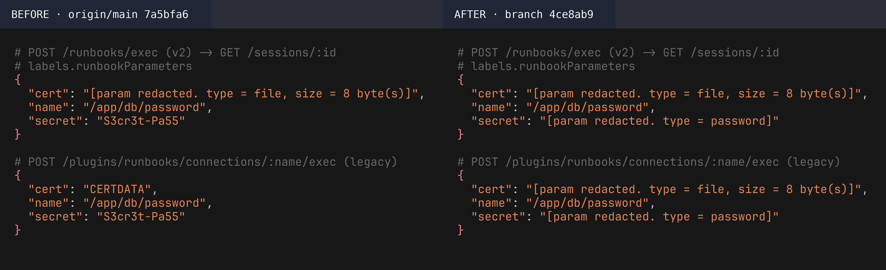
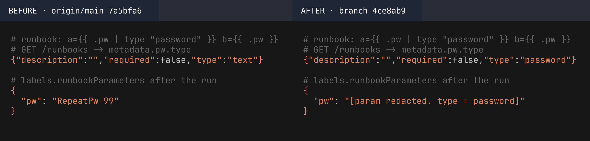
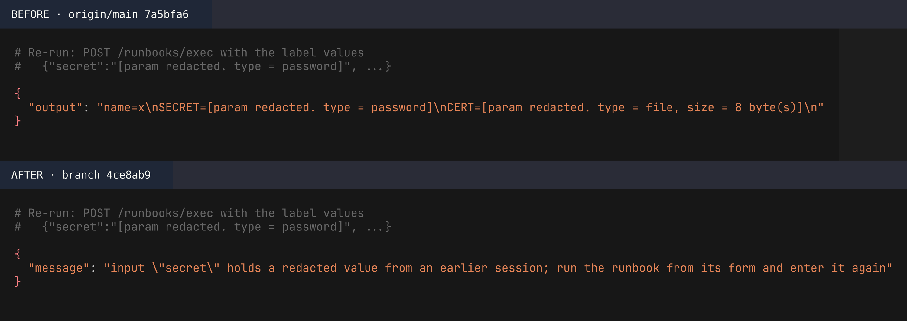
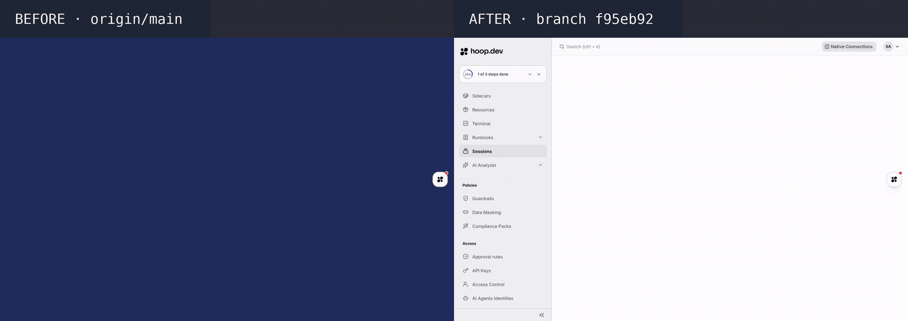

# ENG-1033 · Runbook password inputs are redacted in session labels

PR #2113 · tested on `4ce8ab9` (API) and `f95eb92` (Re-run in the UI) against `origin/main` `7a5bfa6` · 2026-11-04

**Result: a runbook `password` input no longer appears in plain text in the session label, on both exec routes; the run still gets the real value.**

## What changes, and why it is risky
Before, anyone who could read a session (UI, Share link, API) saw the password typed into a runbook form. The risk is the run: if the value were redacted before execution, the runbook would get the marker instead of the secret.

## 1. Is the password stored in the session label?

Look at `secret`: plain text on main, marker on the branch. The legacy route also stored `file` in plain text on main. The script output on the branch still shows `SECRET=S3cr3t-Pa55` (`asenv`).

## 2. A password input referenced twice

On main, the second untyped reference reset the type to `text`: the form showed it unmasked and the label stored it. The branch keeps `password`.

## 3. Re-run sends the label back

On main the run used the marker text as the secret. The branch refuses it with 422 and asks the user to use the form.

## 4. Re-run from the session page

What to look at:
- **Parameters row:** main shows `secret: S3cr3t-Pa55`; the branch shows the marker.
- **After Re-run, left:** main runs again at once and passes the redaction text as the file (`CERT=[param redacted…]`).
- **After Re-run, right:** the branch opens the runbook form with `put-secret.runbook.sh` selected and a notice to enter the hidden inputs again.

## Review env vars
With a review PENDING, the secret appears 0 times (raw or base64) in `GET /sessions/:id`, `GET /reviews` and `GET /reviews/:id` on the branch; once on main, through the label. No API type carries `input_env_vars`; `TestReviewAndSessionTypesDoNotExposeEnvVars` guards it.

## What QA caught on the way
- Repeated input lost its secret type → `TestTemplateParseKeepsSecretTypeOnRepeatedInput`.
- Re-run with redacted values → `TestValidateNotRedactedRefusesLabelMarkers`.
- Guard test matched too few names → widened to any `env`/`secret` field.

## What it solves
Teams that pass secrets through runbooks (for example, into a secret store) no longer expose them to session viewers.

## Open items
- Sessions created before this change keep their labels.
- `private.reviews.input_env_vars` is not cleared (decision: no migration, soft block only).
- Re-run opens the form with the runbook selected; the resource (connection) is not preselected.
- Recorded with `experimental.agents` on (Runbooks menu), as in every org that had an agent.
- CI: all test checks green on 4ce8ab9 (`Sidecar E2E Test` failed on 7115511 for runner disk space, passed on 4ce8ab9). Image publish jobs were still running at write time.
