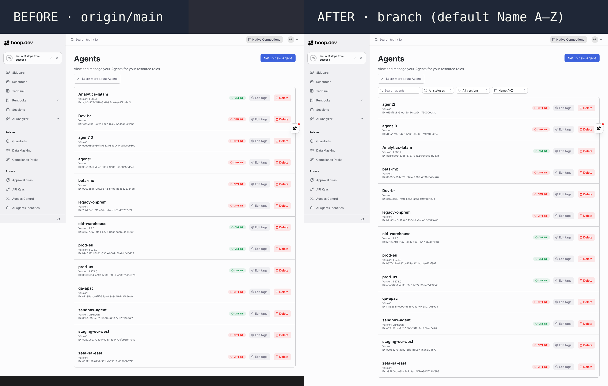
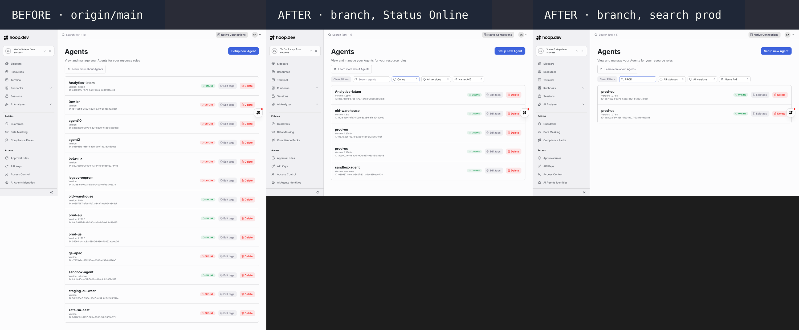
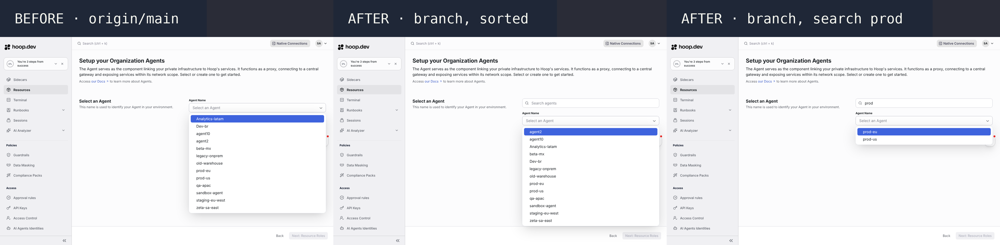
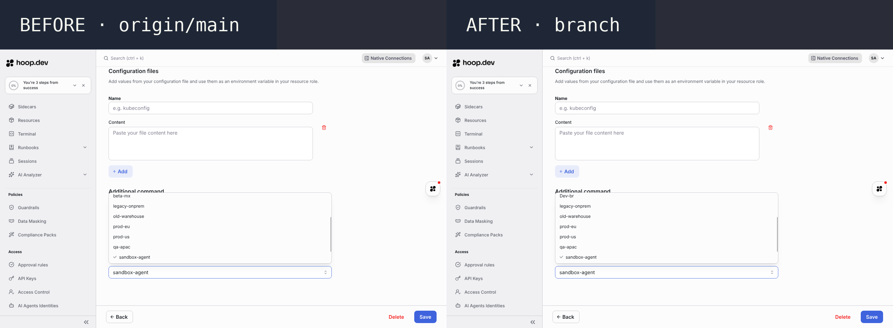

# ENG-1034 · Sort and filter agents on the Agents page and agent pickers

PR #2109 · tested on `a8b0c2b` against `origin/main` `ff3ac67` · 2026-11-04

**Result: with 13 agents, the Agents page can be searched, filtered by status and version, and sorted; both agent pickers list agents by name, and the Create Resource picker can be searched.**

## What changes, and why it is risky
UI only (React Agents page, React Configure picker, CLJS Create Resource picker). No API, agent or wire change. Risk: a wrong filter hides an agent, or the picker loses the selected agent while a search is active.

## 1. Is the Agents page sorted, with filters?

Left: no controls, uppercase names first. Right: search, Status, Version and Sort; default Name A–Z, case-insensitive, agent2 before agent10.

## 2. Do the filters narrow the list?

Status Online keeps the 5 online agents; search "prod" keeps prod-eu and prod-us. "Clear Filters" appears once a filter is set.

## 3. Is the Create Resource picker sorted and searchable?

Left: no search, uppercase first. Middle: sorted by name. Right: "prod" narrows the list.

## 4. Is the Configure Resource picker sorted?

## What QA caught on the way
- The CLJS picker logic had no test → moved to `webapp.resources.setup.agent-options`, guarded by `agent_options_test.cljs`.
- The CLJS picker sorted agent10 before agent2 → now numeric-aware, same order as the React helper.
- Empty and "unknown" versions sorted apart under "Newest version" → grouped last, by name (`agentFilters.test.js`).

## What it solves
Admins with tens of agents (the ticket's customer runs ~30) find an agent by name, status or version instead of scanning an unordered list.

## Open items
- Still screenshots, not a recorded flow: no Docker in this sandbox, and QA's stacks were stopped.
- CLJS karma tests run by hand only: no CI job runs them (true before this PR).
- `Integration Test (mysql)` failed on `a8b0c2b` in `TestMySQL_ParallelSessions` (Go agent code this PR does not touch; it passed on `4764b4d`). It needs a re-run by a person.
