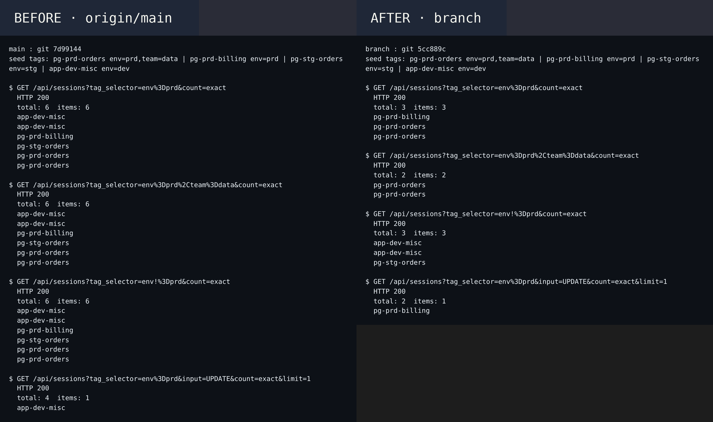
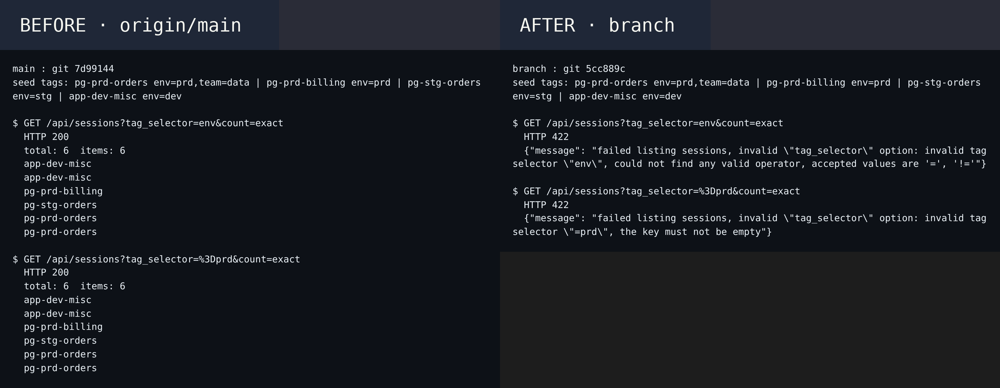

# ENG-1285 · Filter /api/sessions by connection tags

PR #2212 · tested on `5cc889c` against `origin/main` `7d99144` · 2026-11-27

**Result: `GET /api/sessions?tag_selector=env=prd` now returns only the sessions of connections tagged `env=prd`, and `total` counts the same rows. On main the parameter is ignored.**

## What changes, and why it is risky
A new optional filter on the sessions list. If it went wrong, a customer would see wrong session counts in their usage reports. Without the parameter, nothing changes.

## 1. Does tag_selector narrow the sessions, and does it compose with input and count?

Main returns all 6 sessions for every selector. The branch returns 3 for `env=prd`, 2 for `env=prd,team=data`, 3 for `env!=prd`. With `input=UPDATE&count=exact&limit=1`, `total` is 2 (main: 4).

## 2. Is a bad selector refused?

Main ignores `env` and `=prd` and returns everything. The branch returns 422 with the reason.

## What QA caught on the way
QA: PASS, no findings. Qodo found three defects, now fixed: NUL in the selector gave 500 (now 422), no size bound (now 1024 bytes and 16 conditions), and blank segments counted toward the cap. Guards: `TestParseSessionListOptions`, `TestListSessionsTagSelectorAndConnectionPattern`.

## What it solves
A customer can measure read vs. write usage for production connections only, through the API.
The partial name works already: `connection=%25-prd-%25` returns the `-prd-` connections on main and branch (now documented in Swagger).

## Open items
- Qodo security finding open for a person: a non-admin can test the current tags of a connection named in a session they can see, also after losing access to it.
- Matches the current tags, not the tags at session time. A raw, unencoded `%-prd-%` is still dropped by Go's URL parser, as on main.
- CI was still running at capture time.
