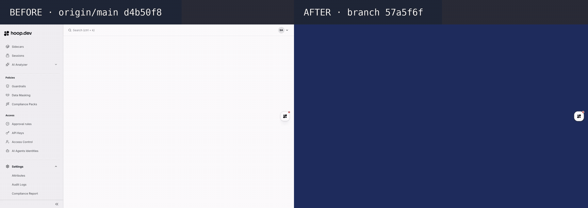
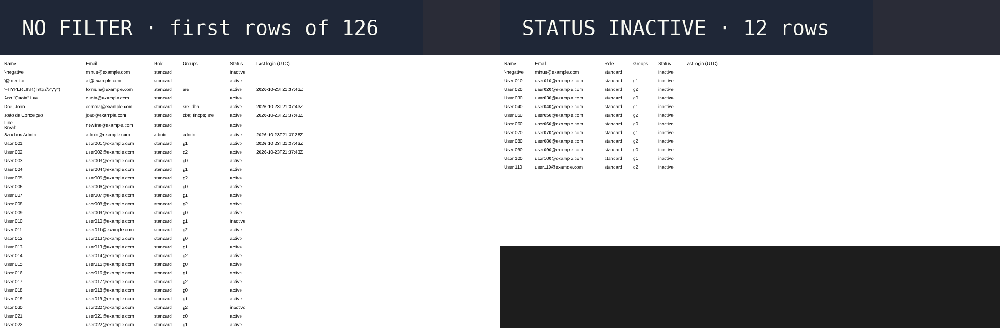

# ENG-877 · Export the Users list to CSV with last login

PR #2040 · tested on `57a5f6f` against `origin/main` `d4b50f8` · 2026-10-23

**Result: admins can download every user, with role, groups, status and last login, as one CSV. Main has no export.**

## What changes, and why it is risky
A new "Export CSV" button on the Users page. It calls `GET /users` without pagination, with the table filters. Frontend only. Risk: a wrong cell (formula, comma, accent) breaks the customer's spreadsheet.

## 1. Does the page export every user, with the filters?

What to look at:
- Header, top right: the branch has "Export CSV" next to "Add User". Main has none.
- The flow: export with no filter (126 rows; the table shows 50 per page), then status "Inactive" and export again (12 rows).

## 2. Is the CSV correct in a spreadsheet?

LibreOffice Calc import of the two downloaded files. `Doe, John`, `Ann "Quote" Lee` and the line-break name stay in one cell. `=`, `-`, `@` names get a leading `'`. `João da Conceição` shows correctly (UTF-8 BOM). Last login is ISO UTC; empty when the user never signed in.

## What QA caught on the way
Round 1: the CSV came in email order, unlike the table. Fixed in `57a5f6f` (sort by name, then email).

## What it solves
RD Station admins get a spreadsheet of all users with last access, without the CLI workaround.

## Open items
- Not opened in Excel or Google Sheets (not in the sandbox). The file starts with the UTF-8 BOM.
- Names that start with a symbol can sort slightly differently from the table (browser vs database collation).
- No unit test for `utils/csv.js`: `webapp_v2` has no test runner. QA's edge-case probe passed.
- `CLAAssistant` is red: the commits are authored `Claude <noreply@anthropic.com>`.
