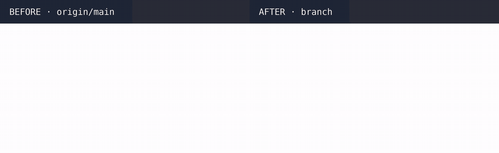

# ENG-934 · The promotion page button stays reachable on short windows

PR #2086 · tested on `91981b7` (component) / `0f3a264` (test) against `origin/main` `4dfa5ae` · 2026-10-29

**Result: on a short window, the user can now scroll to "Get Started", close the Parallel Mode promotion and reach the Runbooks page. On main the button is cut off and the user is stuck.**

## What changes, and why it is risky
The shared promotion page (`webapp/src/webapp/features/promotion.cljs`) centred its left column with `justify-center` inside `overflow-hidden`. When the content is taller than the window, it overflows above and below and cannot scroll. The column now scrolls and centres with `my-auto`, which never pushes content above the top edge.
Risk: every page that uses this component gets the same layout. On a tall window it looks the same.

## 1. Can a user on a short window leave the promotion page?

What to look at:
- Window 1262x660, the size of the customer's screenshot. First visit to `/runbooks`.
- Left (main): after the mouse-wheel scroll, the heading is still cut at the top and "Get Started" stays below the window.
- Right (branch): the scroll brings "Get Started" into view; the click opens the Runbooks library.

## What QA caught on the way
Round 1: no regression test. `webapp/test/webapp/features/promotion_test.cljs` now checks the button is inside the scrolling column and no column uses `justify-center`. Both tests fail on main's component.

## What it solves
Users on laptops or zoomed browsers can dismiss the Parallel Mode promotion and use Runbooks and the Web Terminal.

## Open items
- CI runs no CLJS tests: the new test runs only by hand (`npx shadow-cljs compile karma-test && npx karma start --single-run`). It checks the markup, not the real layout.
- On `/features/machine-identities` at 1262x595, the button was visible on load on main; on the branch the user scrolls to it. It is still reachable.
- The promotion flag is in `localStorage`: in an incognito window the promotion shows again on each new session. Not changed here.
