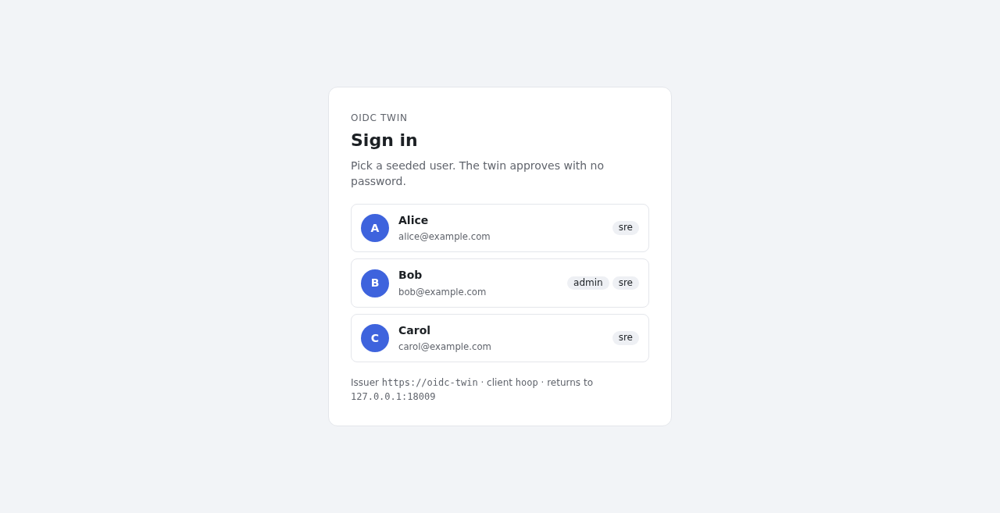
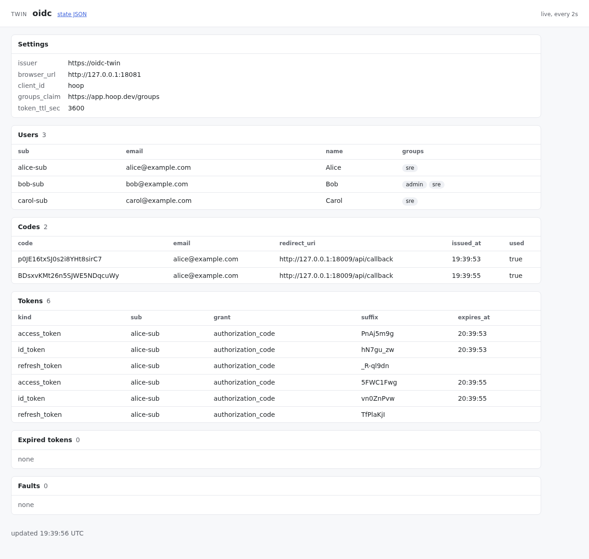

# twins

Behavioral clones ("twins") of the third-party services hoop calls, and the
scenarios that drive the real `hoop` binary against them with no real
account. ADR-0032 (hoophq/adr) decides the layout.

```
scenario (go test) ──HTTP──> /api/*  of  hoop start standalone ──HTTPS_PROXY──> router ──> oidc twin
        └──────────HTTP──> /_twin/seed|state|reset|faults        (gateway, PGlite, agent)        (issuer https://oidc-twin)
browser ──HTTP──> web UI :18009 ──login_url──> oidc twin /authorize on :18081 (plain HTTP) ──> /api/callback
        └──HTTP──> /_twin/ui of each twin
```

- `kit/`: what every twin shares. The admin API, failure injection, the
  test PKI, the TLS and admin listeners.
- `oidc/`: the OIDC provider twin and its contract suite.
- `router/`: the `HTTPS_PROXY` the gateway uses. It tunnels a twin's
  hostname to the twin and refuses any other host.
- `scenario/`: the runner and the scenarios (build tag `scenario`; the
  browser scenarios add `browser`, and `twins-up`/`twins-down` add
  `twinsup`).
- `cmd/twins/`: one binary, `twins pki|oidc|router`.

One module, `github.com/hoophq/hoop/twins`, outside `go.work`. It imports
nothing from hoop: the scenarios drive the binary over HTTP.

## Run it

```bash
make test-twins            # kit, router and twin tests, contract suites
make test-twins-scenario   # boots hoop against the twins; Linux natively, Docker elsewhere
make test-twins-browser    # the same stack with the web UI, driven by a headless Chrome
make twins-up              # the stack with the web UI, left up for your browser
make twins-down            # stops it
```

| Variable | Effect |
|---|---|
| `TWINS_REACH=native\|proxy` | `native`: every process on this host, Linux only, because darwin ignores `SSL_CERT_FILE`. `proxy`: the same stack under docker compose. Default: `native` on Linux, `proxy` elsewhere. |
| `HOOP_BIN_DIR=dir` | Use `dir/hoop` and build none. A linux binary for `proxy`. |
| `HOOP_UI_DIR=dir` | A stack with the web UI serves `dir` (it holds `index.html`) and builds none. Else it runs `scripts/dev/build-webapp.sh` (npm and Java) and serves `dist/dev/resources/public`. |
| `TWINS_ARTIFACTS=dir` | Keep `oidc-state.json`, `router-state.json`, `timings.txt`, the logs and the browser's `screenshots/`. Default: a temp dir, or `dist/twins-up` for a stack that stays up. |
| `TWINS_KEEP=1` | Leave the stack up after the run, failed or not. `make twins-down` stops it. |
| `TWINS_CHROME=path` | The Chrome binary of the browser scenarios. Default: the one chromedp finds. |

The native stack uses these ports: the gateway listens on all interfaces at
18009 (API) and 8010 (gRPC, fixed by the gateway); the OIDC twin at
`127.0.0.1:18081` (admin) and `127.0.0.1:18441` (TLS); the router at
`127.0.0.1:18083`. One native stack runs per host. A native run deletes
`<TWINS_ARTIFACTS>/native` first, so it always boots on an empty database.

At boot, the stack logs alice in first: she is the org's first user, so
she is admin. Her token lets the runner wait for the standalone agent to
report `CONNECTED` before the first scenario. A scenario's own users log in
after her.

## In a browser

`make twins-up` builds hoop and the web UI from this branch, boots the
stack, seeds alice, bob and carol, prints the URLs and returns. The stack
stays up (containers under `proxy`, processes in their own process group
under `native`) until `make twins-down`. The UI build runs `npm install`,
which can rewrite the `package-lock.json` files; `HOOP_UI_DIR` reuses a
build instead.

Open `http://127.0.0.1:18009`. The login page of hoop sends an OIDC
user to the IdP by itself, so the first page is the twin's: it lists the
seeded users. Pick one and hoop signs you in as that user. No step asks
for a certificate: the browser reaches the twin's authorize endpoint on
its admin port, in plain HTTP.



Each twin serves `/_twin/ui`: its state as a page that fetches itself
every 2s. A scalar is a setting, a list is a section, and a list of
objects is a table, in the order of the state document. The OIDC page
shows the users and their groups, the codes and the tokens.



`TestBrowserLogin` (`make test-twins-browser`) runs this flow in a
headless Chrome through chromedp, and saves a screenshot of each step in
`<TWINS_ARTIFACTS>/screenshots`. CI runs it nightly and on
`workflow_dispatch` (`.github/workflows/twins-browser.yml`), with the UI
build cached by a hash of `webapp/` and `webapp_v2/`. The PR job stays
API-only.

## After the scenarios

After its last scenario, a stack waits 10s, then fails on any host the
gateway tried that no twin answers. `knownEgress` in `scenario/stack_test.go`
lists the accepted hosts, each with its reason.

## The admin API

Every twin serves it on its admin port (plain HTTP) and on its TLS port.

| Route | Effect |
|---|---|
| `POST /_twin/seed` | Load state. More calls add to it. |
| `GET /_twin/state` | What a scenario asserts on, plus the faults and their hits. |
| `POST /_twin/reset` | Drop all state and faults. |
| `POST /_twin/faults` | `{"path": "/jwks", "status": 503, "body": "", "delay_ms": 0, "times": 0}`. Matches a path prefix. `times: 0` means until cleared. |
| `DELETE /_twin/faults` | Drop the faults, keep the state. |
| `GET /_twin/healthz` | `ok`. |
| `GET /_twin/ui` | The state as a page that refreshes itself. Read-only. |

With no `login_hint`, the OIDC twin's `/authorize` serves the login page
of the seeded users. Each user is a button that sends the same request with
`login_hint`. An unknown `login_hint` answers 400. `-browser-url` sets where
discovery advertises `authorization_endpoint` (default: the issuer); the
stack sets it to the admin port. `token`, `userinfo` and `jwks` stay on the
issuer, reached over TLS through the router.

OIDC twin seed fields: `users` (`sub`, `email`, `name`, `groups`; the same
email replaces the user), `groups_claim` (default
`https://app.hoop.dev/groups`), `client_id` and `client_secret` (default
`hoop`, `hoop-secret`), `token_ttl_sec` (default 3600), and
`expired_tokens`: `["id_token"]` or `["access_token"]` makes the token
endpoint issue them already expired; `[]` stops it. 429, 5xx and latency
are kit faults on the endpoint path. `/_twin/state` returns the users, the
codes and the tokens issued (kind, subject, grant, expiry, last 8
characters).

## OIDC contract suite

`oidc/contract_test.go` checks what hoop needs from a provider: discovery,
JWKS, token endpoint errors, refresh, userinfo with the groups claim. It
runs against an in-process twin. Set these to run it against a real issuer
instead; a difference means the twin is wrong:

| Variable | Value |
|---|---|
| `TWINS_OIDC_ISSUER` | The issuer URL, as hoop is configured. |
| `TWINS_OIDC_CLIENT_ID`, `TWINS_OIDC_CLIENT_SECRET` | A confidential client of that issuer. |
| `TWINS_OIDC_REFRESH_TOKEN` | A refresh token of a user in at least one group, from that client. Turn off refresh token rotation, or the next run fails. |
| `TWINS_OIDC_GROUPS_CLAIM` | Optional. Default `https://app.hoop.dev/groups`. |

```bash
TWINS_OIDC_ISSUER=https://example.okta.com ... make test-twins
```

## What is real and what is faked

| Piece | In a scenario | In production |
|---|---|---|
| hoop gateway, agent, CLI | the real binary from this branch, unmodified | the same |
| database | embedded PGlite (`hoop start standalone`) | PostgreSQL |
| IdP | OIDC twin: discovery, authorize, token (`authorization_code`, `refresh_token`), userinfo, JWKS. RS256 key minted at start | Okta, Auth0, Entra, Google... |
| gateway config | `IDP_ISSUER`, `IDP_CLIENT_ID`, `IDP_CLIENT_SECRET` env | env or `PUT /api/serverconfig/auth` |
| login | a scenario follows the redirects over HTTP, and `login_hint` names the seeded user; a browser picks one on the twin's page. Authorize approves with no password | a browser, a password, MFA |
| web UI | the build of this branch, from `STATIC_UI_PATH`, in a stack with the web UI | embedded in the release binary, or `/app/ui/public` |
| users and groups | `/_twin/seed` | the IdP directory |
| TLS | a test CA minted per run, trusted through `SSL_CERT_FILE` only, which replaces the system roots | public CAs |
| DNS | none: the router maps the twin's hostname | public DNS |
| egress | the router refuses any host with no twin and records it | the internet |

## Not covered

- A scenario for the CLI `hoop login`, which listens on `127.0.0.1:3587`.
- SAML (ENG-695).
- Vendor directory group APIs (Auth0, Entra Graph, Google `cloudidentity`): no handler calls `ListDirectoryGroups`.
- Runtime config through `PUT /api/serverconfig/auth`.
- Opaque access tokens and `_userinfo=1`: the twin issues JWT access tokens only.
- Registered redirect URIs, consent, MFA and `prompt`: authorize approves any absolute `redirect_uri`.
- Refresh token rotation and revocation: a refresh token stays valid until reset.
- Key rotation: one signing key per run.
- PKCE and `nonce` checks: the gateway sends neither. The twin echoes a `nonce` it receives.
- Released agents (ENG-698) and the nightly contract run against sandbox accounts (ENG-699).
